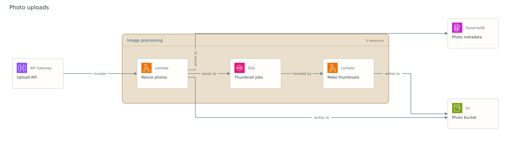

# Architecture diagrams

Describe a system in your own words and Elwing draws it as an AWS architecture diagram. Each
resource gets its official service icon, every arrow is labelled with what one service does to
another, and related resources can sit together in a named group.

## Ask for a diagram

> Draw an architecture diagram for our photo upload service. An API Gateway endpoint called
> "Upload API" invokes a Lambda that resizes photos. The resizer writes the photo to an S3 bucket,
> writes metadata to DynamoDB, and sends a job to an SQS queue. A second Lambda handles the queue
> and writes thumbnails back to the bucket. Group the two Lambdas and the queue as "Image
> processing".

You don't need to know service IDs or Elwing's vocabulary. Name the services the way you normally
would.

## What you get

Your agent replies with the image and the saved diagram's ID. The diagram is saved, so you can come
back later and [edit it](editing-diagrams.md) by name or ID.

## What happens behind the scenes

1. The agent reads Elwing's readability guide and looks up each service in the catalog to get its
   exact ID and the relationships it supports, such as API Gateway _invokes_ Lambda or Lambda
   _writes to_ S3.
2. It creates a diagram called "Photo uploads" and adds the resources, arrows and group in one
   change.
3. Elwing arranges the layout automatically, left to right, then checks readability. This diagram
   returned no findings.
4. It exports the image.

Elwing only accepts relationships the catalog supports. If you describe an arrow that AWS doesn't
offer, such as S3 _writes to_ DynamoDB, the agent gets an error that lists the allowed verbs and
adjusts the diagram or asks you what you meant.

## Tips

- **Name each resource by its job.** "Resize photos" and "Make thumbnails" read better than two
  cards that both say "Lambda".
- **Ask for groups** when you want boundaries such as a VPC, a team's services or a processing
  stage. A resource can belong to one group, and groups can't be nested.
- **Ask for a custom resource** for something outside AWS, such as "an external payment provider".
  It appears as a generic card with your own heading.
- **Use the built-in prompt.** MCP clients that support prompts offer
  `design_architecture_diagram`. Give it a description, and optionally an existing diagram ID, and
  it walks the agent through the same steps.
- Diagrams can hold up to 200 resources and groups and 1,000 arrows.

## Related

- [Flow charts](flow-charts.md) for processes rather than infrastructure.
- [Badges](badges.md) to highlight what's new in a proposal.
- [Export images and files](../sharing/exports.md) for other formats.
