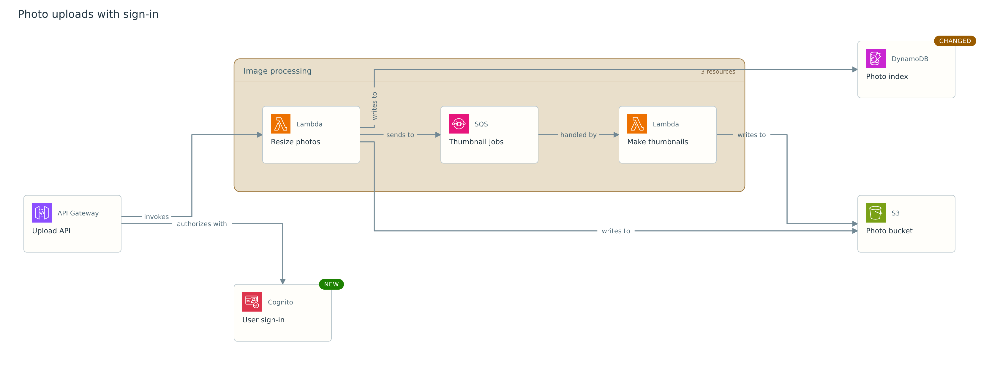

# Badges

A badge is a small coloured label on the corner of a resource card. Use badges to show which parts
of a diagram are new, changed or planned, for example in a design review where most of the system
already exists.

## Ask for badges

> On the "Photo uploads with sign-in" diagram, badge User sign-in as NEW and badge Photo index as
> CHANGED in amber.

## What you get

Each badge sits centred on the card's top-right corner. When the diagram is arranged, Elwing leaves
extra room so badges don't collide with neighbouring cards.

## Choosing labels and colours

- **Labels** are 1–12 characters and always shown in upper case, such as NEW, CHANGED, PLANNED or
  V2.
- **Colours** default to green (`#1d8102`). Ask for any other colour by name or hex code, such as
  "amber" or `#9a5b00`. Elwing picks dark or white text automatically for contrast.
- **Removing** a badge: "Remove the badge from User sign-in."

## When the agent adds badges on its own

The agent adds NEW badges without being asked only when a diagram mixes new and existing
architecture, for example when you ask it to "add a caching layer to my existing diagram". A
diagram that is entirely new gets no badges unless you request them.

## Limits

Badges apply to resource cards only. Groups and flow chart shapes can't carry badges.

## Related

- [Edit an existing diagram](editing-diagrams.md)
