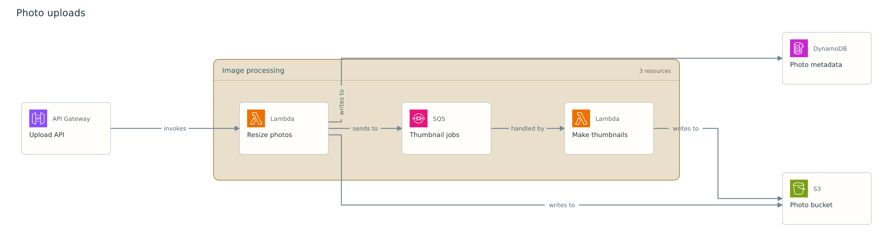
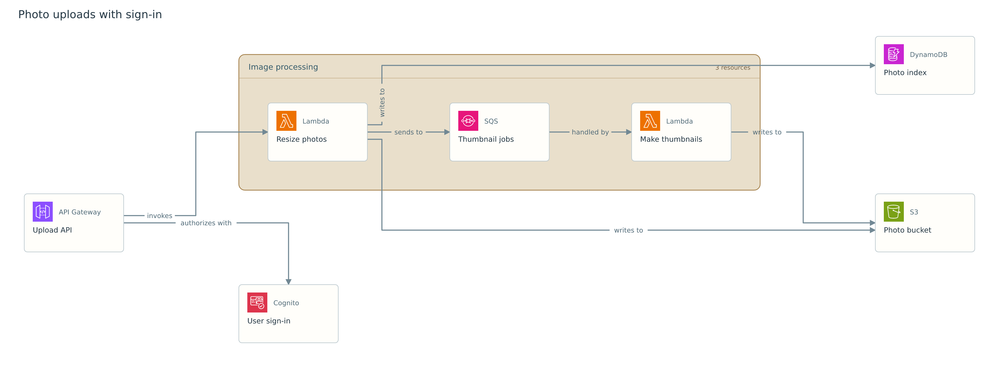

# Edit an existing diagram

Saved diagrams stay editable. Ask your agent to change a diagram in plain language and Elwing
applies the whole change at once. Either every part succeeds or nothing changes.

## Ask for a change

Starting from the [photo upload diagram](architecture-diagrams.md):

> In my "Photo uploads" diagram, add Cognito for user sign-in and have the Upload API authorize with
> it. Rename "Photo metadata" to "Photo index" and rename the diagram to "Photo uploads with
> sign-in". Then tidy the layout.

## What you get

**Before**

**After**

The new Cognito card is connected to the API, the DynamoDB card shows its new name and the layout
is rearranged around the addition. Everything you didn't mention, including the group, the other
arrows and their labels, is unchanged.

## What you can change

| Ask for                                     | Example request                                    |
| ------------------------------------------- | -------------------------------------------------- |
| Add, rename or remove a resource            | "Remove the thumbnail queue."                      |
| Add, relabel or remove a connection         | "The resizer also reads from the bucket."          |
| Create a group, rename it or change members | "Move the bucket into the Image processing group." |
| Move a group                                | "Move the Image processing group further right."   |
| Rename the diagram                          | "Call this diagram Photo service v2."              |
| Rearrange everything                        | "Tidy the layout."                                 |
| Add or remove a badge                       | See [Badges](badges.md).                           |

If you don't remember the diagram's name, ask the agent to [list your
diagrams](../management/manage-diagrams.md) first.

## Good to know

- **The agent reads before it writes.** It fetches the current diagram, so it edits what is really
  saved, not what it remembers.
- **No half-finished edits.** If one part of a request is invalid, such as an arrow AWS doesn't
  support, the whole batch is rejected and the diagram stays as it was. The agent sees why and can
  fix the request.
- **Safe with other sessions.** Every edit names the revision it expects. If the diagram changed in
  another session, Elwing rejects the stale edit and the agent rereads the latest version before
  trying again.
- **Manual positions.** Rearranging repositions the whole diagram. If you have placed cards by
  hand, ask the agent not to rearrange.

## Related

- [Readability checks](../quality/readability-checks.md) after larger edits.
