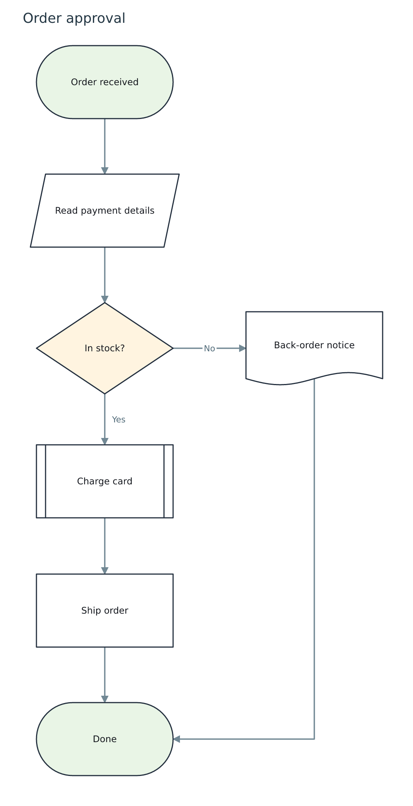

# Flow charts

Describe a process step by step and Elwing draws it as a flow chart. Flow charts use standard
shapes instead of AWS icons, run top to bottom, and put labelled Yes/No branches next to each
decision.

## Ask for a flow chart

> Make a flow chart called "Order approval". When an order is received, read the payment details,
> then check whether the item is in stock. If it is, charge the card as a subprocess, ship the
> order and finish. If it isn't, send a back-order notice and finish.

## What you get

Elwing lays the chart out top to bottom. The Yes path continues straight down and the No branch
moves to the right of the decision. The readability check for this chart returned no findings.

## Shapes

Pick the shape by what the step is. You can name the shape in your request or let the agent choose.

| Shape        | Looks like                 | Use it for                              |
| ------------ | -------------------------- | --------------------------------------- |
| Start/end    | Rounded pill (green)       | Where the flow begins or finishes.      |
| Process      | Rectangle                  | A single step, such as "Ship order".    |
| Decision     | Diamond (amber)            | A question. Label each outgoing arrow.  |
| Input/output | Parallelogram              | Data coming in or going out.            |
| Document     | Rectangle with a wavy base | A document or report the step produces. |
| Subprocess   | Rectangle with side bars   | A step that is its own flow elsewhere.  |

## Tips

- **Label decision branches.** Ask for "Yes" and "No" (or any short text) on the arrows leaving a
  decision. Other arrows can have labels too, or none.
- **Flow charts stand alone.** Flow chart shapes can't be placed in groups, and their arrows can't
  point at a group.
- **Prefer left to right?** Ask the agent to "arrange it left to right".
- **Changing a step later** works the same as [editing any diagram](editing-diagrams.md): "Add a
  'Notify customer' step after Ship order."

## Related

- [Architecture diagrams](architecture-diagrams.md) for AWS infrastructure.
- [Background colours](../sharing/backgrounds.md): flow chart outlines are dark, so pick a light
  background for dark slides.
