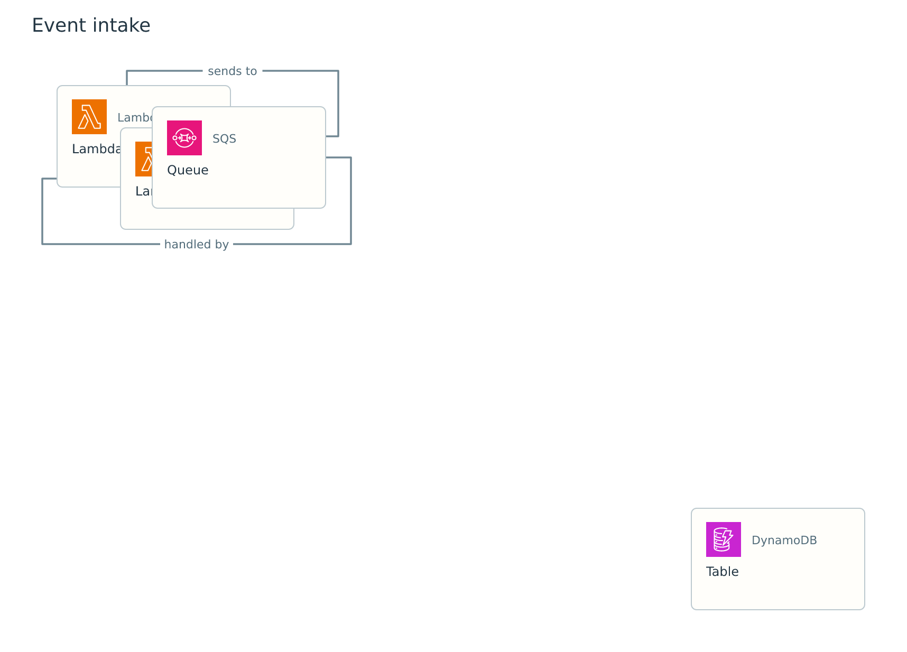
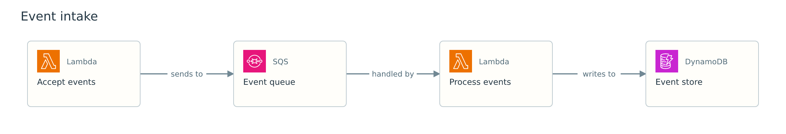

# Readability checks

Elwing can review a saved diagram and point out problems a reader would trip over: cards stacked on
top of each other, names that don't say what a resource does, resources with no connections, and
areas with too many arrows. The agent runs this check before every export, and you can ask for it
at any time.

## Ask for a check

> Is my "Event intake" diagram readable? Fix anything that isn't.

## What you get

This diagram was built by placing cards by hand, without automatic layout:

The check returned five findings:

| Finding               | Affects                     | What Elwing suggests                                                           |
| --------------------- | --------------------------- | ------------------------------------------------------------------------------ |
| Overlapping resources | Both Lambdas                | Separate these cards so names and connection endpoints are readable.           |
| Overlapping resources | First Lambda and the queue  | Same as above.                                                                 |
| Overlapping resources | Second Lambda and the queue | Same as above.                                                                 |
| Duplicate name        | Both Lambdas                | Distinguish these resources by role or scope if the shared name is ambiguous.  |
| Isolated resource     | The DynamoDB table          | Explain this resource's role, or connect it only if a real interaction exists. |

The agent then renamed each resource by its job, connected the table the processor writes to,
rearranged the layout and checked again. The second check returned no findings:

## What the check looks for

- Overlapping cards
- Blank, unclear or duplicate names
- Long or vague arrow labels
- Resources with no connections
- Crowded areas with many connections

## Good to know

- **Checking never changes your diagram.** Fixes are separate edits that the agent makes, or
  proposes, afterwards.
- **Findings are advice.** An isolated resource might be intentional, such as a shared logging
  bucket. Tell the agent to leave it and it will.
- **A clean result is about layout and labels, not architecture.** It doesn't prove the design is
  correct.
- Elwing returns up to 50 findings at a time, along with the full count.

## Related

- [Edit an existing diagram](../diagrams/editing-diagrams.md)
- [Export images and files](../sharing/exports.md)
