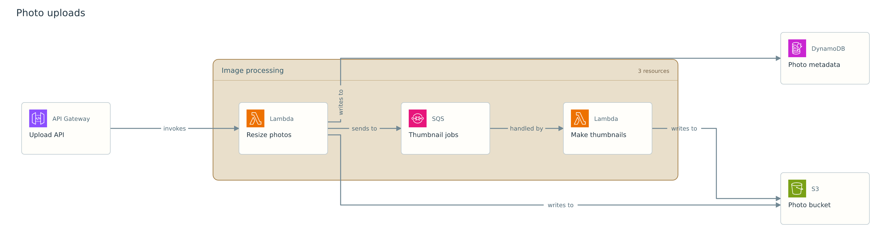
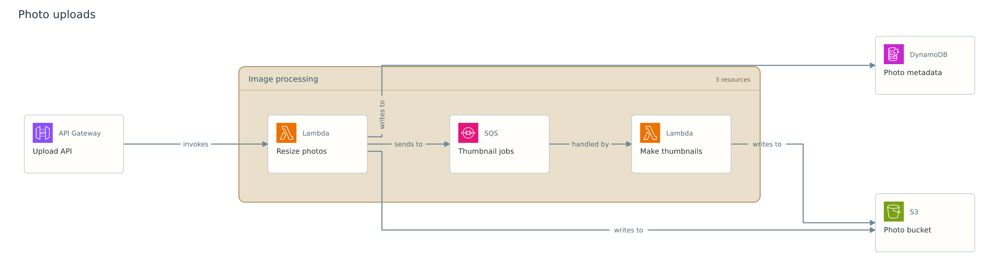
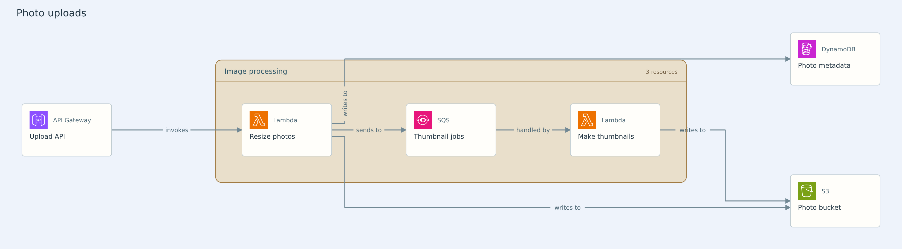

# Background colours

Exports have a transparent background by default, so diagrams blend into whatever page they sit on.
You can ask for any solid colour instead. Cards, groups and shapes always stay opaque; only the page
behind them changes.

## Ask for a background

> Export "Photo uploads" as a PNG.

> Export "Photo uploads" as a PNG with a white background.

> Export "Photo uploads" with background `#eef3fb` to match our slide template.

## What you get

| Request                 | Result                                                                                                                                             |
| ----------------------- | -------------------------------------------------------------------------------------------------------------------------------------------------- |
| No background (default) |  |
| White, `#ffffff`        |              |
| Pale blue, `#eef3fb`    |         |

The transparent image takes on the colour of this page, so in a dark theme it looks dark.

## Choosing a colour

- **Light pages and documents:** keep the default transparent background.
- **Dark slides or dark mode:** ask for a light colour such as white. The diagram title, flow chart
  outlines and arrow labels are dark and fade on a dark page.
- **Branded slides:** give the hex code, `#RRGGBB` or `#RGB`. Colour names such as "blue" aren't
  accepted directly; the agent converts them or asks you for a code.

## Where it applies

The background setting works for SVG, PNG and Excalidraw exports. A transparent PNG keeps its alpha channel, a transparent SVG has
no page rectangle, and an Excalidraw file uses the colour as its canvas background.

## Related

- [Export images and files](exports.md)
