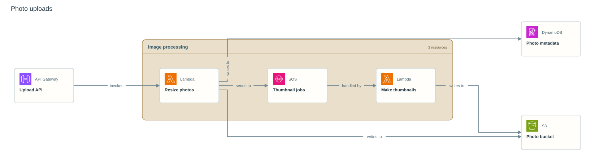
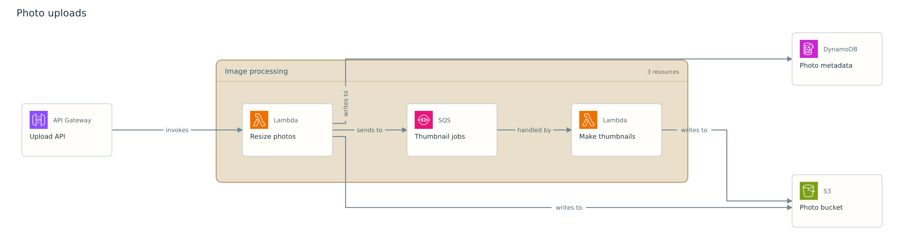

# Export images and files

Ask for a diagram in the format you need. Elwing renders the latest saved version and returns the
file to your agent, which can show it, save it or attach it.

| Format     | Best for                                             | Notes                                     |
| ---------- | ---------------------------------------------------- | ----------------------------------------- |
| SVG        | Docs, wikis and web pages; sharp at any size         | Default alongside PNG.                    |
| PNG        | Slides, chat and email                               | Rendered at up to twice the diagram size. |
| Excalidraw | Hand-editing in [Excalidraw](https://excalidraw.com) | Only when you ask for it.                 |

## Ask for an export

> Export my "Photo uploads" diagram as SVG and PNG and save them in `./diagrams`.

> Give me the "Photo uploads" diagram as an Excalidraw file so I can tweak it by hand.

## What you get

**SVG** ([download](images/photo-uploads.svg)):

**PNG** ([download](../diagrams/images/architecture-photo-uploads.png)):

**Excalidraw** ([download](images/photo-uploads.excalidraw)): open the file at
[excalidraw.com](https://excalidraw.com) with **Open** or drag it onto the canvas. Each card stays
grouped with its icon and text, and arrows stay attached to their cards when you move them.

The agent also receives the file name, pixel size and the diagram revision it rendered, so it can
tell you exactly which version you're looking at.

## Good to know

- **Exports are transparent by default.** See [Background colours](backgrounds.md) for white or
  coloured pages.
- **Exports never change the diagram**, and they don't fix layout problems. The agent runs a
  [readability check](../quality/readability-checks.md) first.
- **Excalidraw differences:** Excalidraw uses its own fonts and doesn't draw the small gaps where
  arrows cross. After moving cards, you may need to adjust arrow bends.
- **Where files go:** the file arrives inside the agent's tool response, and the server also saves
  a copy under `exports/` in its [data folder](../../../README.md#files-and-recovery). The response
  includes that file's path.
- **Size limits:** an export must be under 5 MB, and a PNG can be at most 8,192 pixels per side and
  16 million pixels in total. For very large diagrams, use SVG or split the diagram.
